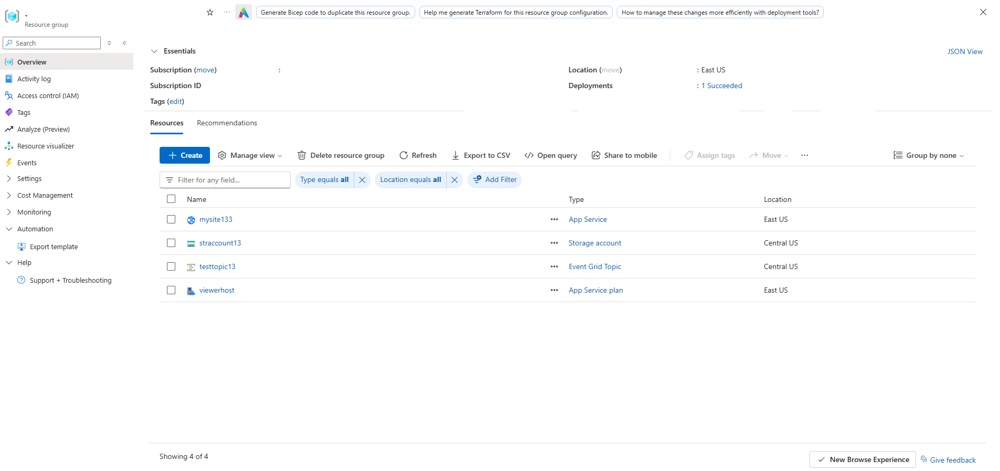
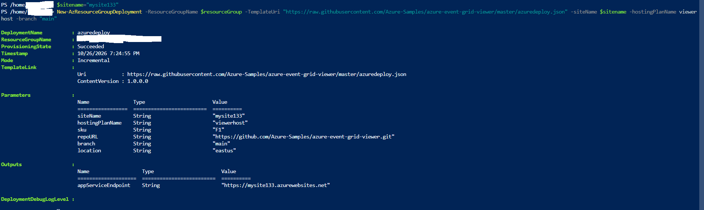
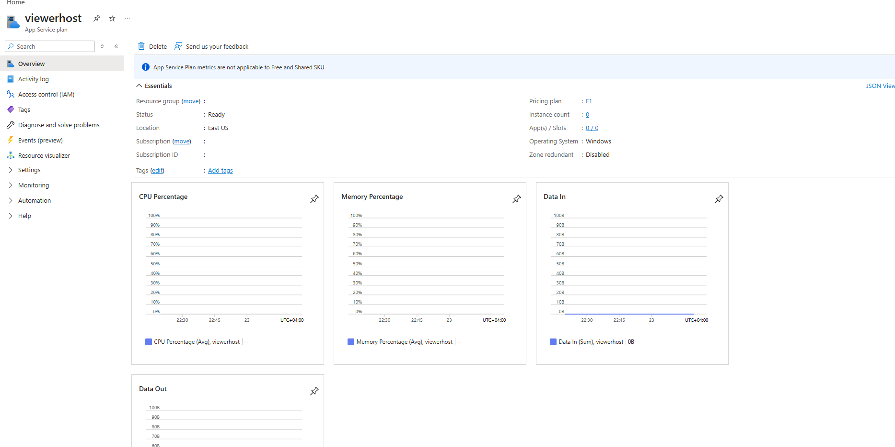
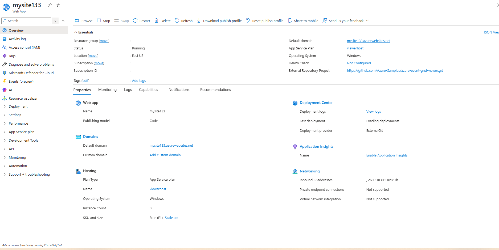
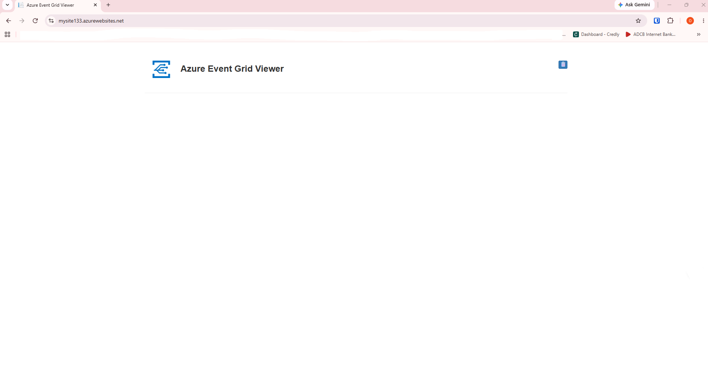
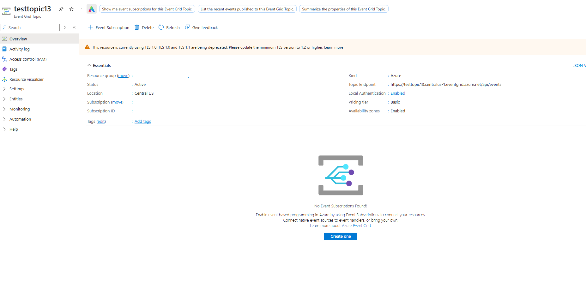
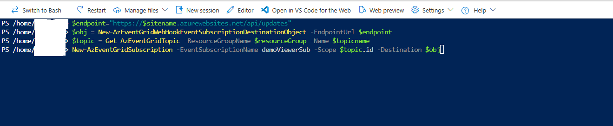
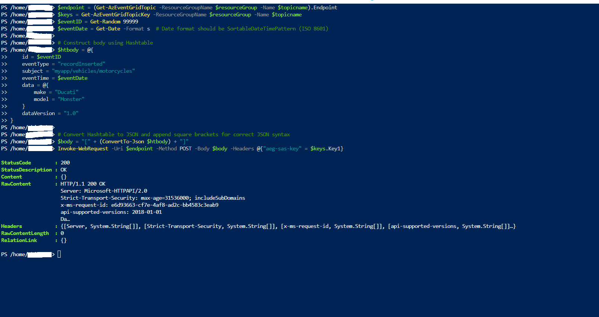
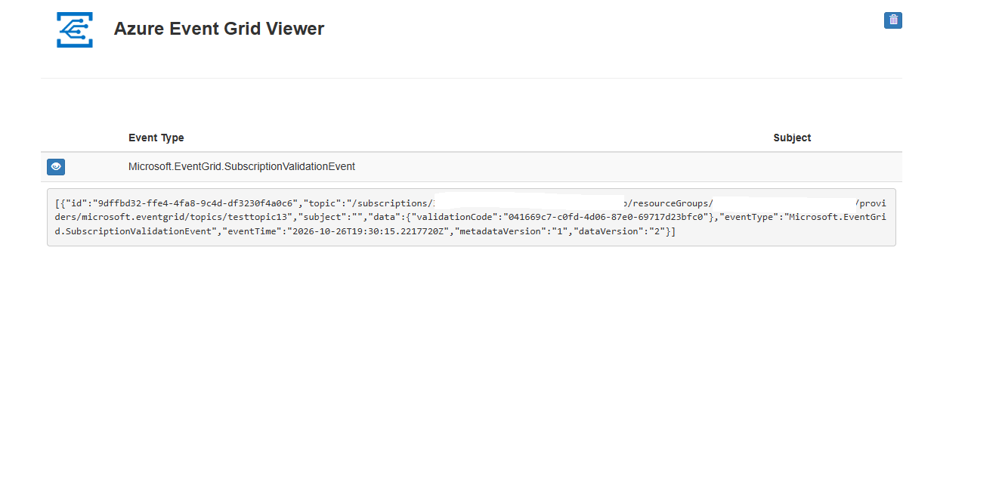
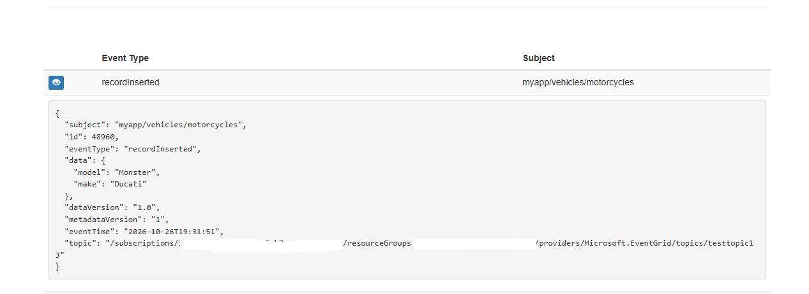

# Route Custom Events to Web Endpoint with PowerShell and Event Grid

---

## 1. Architecture & Provisioned Resources

### Core Infrastructure Topology

| Resource Type | Resource Name | Specification / Purpose | Region / Location |
| :--- | :--- | :--- | :--- |
| **App Service** | `mysite133` | Web application hosting the Azure Event Grid Viewer | East US |
| **App Service Plan** | `viewerhost` | Free (F1) App Service plan hosting the viewer site | East US |
| **Event Grid Topic** | `testtopic13` | Custom Event Grid Topic for publishing event schemas | Central US |
| **Storage Account** | `straccount13` | General Purpose V2 storage (`Standard_LRS`) | Central US |
| **Event Subscription** | `demoViewerSub` | WebHook subscription routing events to `/api/updates` | Global |

---

### Provisioned Environment Validation

*Resource group inventory confirming successful deployment of App Service, Storage Account, Event Grid Topic, and App Service Plan.*

---

## 2. Step-by-Step Implementation

### Step 1: Deploy Web Endpoint (Event Grid Viewer)

1. Deployed the Azure Event Grid Viewer web application using a remote ARM deployment template via PowerShell.
2. Verified successful creation of the App Service plan `viewerhost` and Web App `mysite133`.

*PowerShell output confirming successful ARM template deployment of the Event Grid Viewer web app.*

---

*App Service plan viewerhost overview confirming F1 Free tier provisioning in East US.*

---

*App Service overview for mysite133 confirming web app status and default domain.*

---

*Azure Event Grid Viewer web site interface loaded and ready to receive events.*

---

### Step 2: Create Custom Event Grid Topic

1. Provisioned a custom Event Grid Topic named `testtopic13` in the `centralus` region using `New-AzEventGridTopic`.
2. Confirmed active topic state and endpoint URL creation in the Azure Portal.

*PowerShell command executing New-AzEventGridTopic to create custom topic testtopic13.*

---

*Event Grid Topic overview in Azure Portal confirming active status in Central US.*

---

### Step 3: Subscribe to Custom Topic

1. Configured a WebHook event subscription named `demoViewerSub` targeting the `mysite133` endpoint (`/api/updates`).
2. Executed `New-AzEventGridSubscription` in PowerShell to initiate subscription handshake and event delivery routing.

*PowerShell script creating the WebHook event subscription for testtopic13.*

---

### Step 4: Send Custom Event to Topic

1. Constructed a custom JSON event payload containing event type `recordInserted` and subject `myapp/vehicles/motorcycles`.
2. Published the event to the topic endpoint using `Invoke-WebRequest` with the topic SAS key.

*PowerShell script constructing custom JSON event body and sending POST request to topic endpoint.*

---

## 3. Verification & Monitoring

### Step 1: Verify Subscription Handshake Event

1. Accessed the live Event Grid Viewer web application URL (`https://mysite133.azurewebsites.net`).
2. Validated receipt of `Microsoft.EventGrid.SubscriptionValidationEvent` confirming successful WebHook handshake registration.

*Event Grid Viewer web application receiving and confirming the subscription validation event.*

---

### Step 2: Verify Custom Event Delivery Payload

1. Monitored real-time event stream in the Event Grid Viewer application following custom event publication.
2. Verified receipt and formatting of the `recordInserted` event payload containing motorcycle attributes (`Ducati` / `Monster`).

*Azure Event Grid Viewer displaying the received recordInserted event payload with custom subject and data.*
